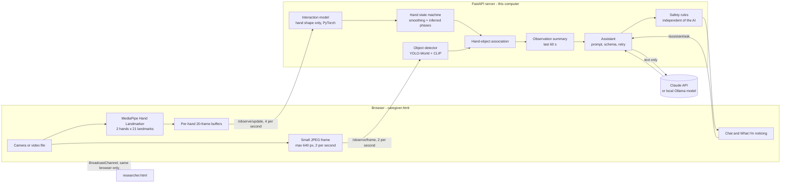

# Motio v1: AI-Supported Play Observation for Caregivers

Motio is a research prototype that watches a young child's play through a camera, recognises
hand activity and nearby play objects, and gives the caregiver simple, age-appropriate play
ideas that support fine-motor practice, through a conversational AI.

This is **version 1, the first end-to-end MVP**: camera, hand model, object detector,
observation summary, language model and caregiver interface work together.

> **Research prototype only.** Motio is not a medical device. It does not assess, diagnose or
> monitor development, and its observations are uncertain estimates. It is designed for
> caregiver support and play enrichment.

---

## Contents

1. [What v1 does](#1-what-v1-does)
2. [System architecture](#2-system-architecture)
3. [Models](#3-models)
4. [What was done: development log](#4-what-was-done-development-log)
5. [Results so far](#5-results-so-far)
6. [Running v1](#6-running-v1)
7. [Configuration](#7-configuration)
8. [API](#8-api)
9. [Repository layout](#9-repository-layout)
10. [Tests and tools](#10-tests-and-tools)
11. [Privacy and safety design](#11-privacy-and-safety-design)
12. [Known limitations](#12-known-limitations)
13. [Next steps](#13-next-steps)
14. [Dataset and attribution](#14-dataset-and-attribution)

---

## 1. What v1 does

**Caregiver page** (`/app/caregiver.html`): a light, simple page.

- Live camera (laptop webcam, phone camera or a prerecorded video), with optional gentle
  overlays showing tracked hands and spotted toys.
- **What I'm noticing:** a plain-language summary such as *"Hand 1: probably holding the
  block"*, plus chips for the toys in view. No numbers or technical detail.
- **Ask Motio:** a chat with the child's age and quick questions ("What can we play next?",
  "Use these toys", "What skills?"). Answers arrive as an activity card:
  - what you need
  - steps
  - why it helps
  - safety notes
  - **Make it easier**, **Make it harder** and **Something different** buttons

**Researcher page** (`/app/researcher.html`): for the researcher only. It mirrors the caregiver
page live, through a channel that only works in the same browser on the same computer:

- the camera, with detailed overlays
- per-hand probabilities and inferred phases
- the objects table, with confidences and timing
- the event log
- every AI exchange in full: model, tokens, cost, safety-check notes, raw answer and the exact
  observation sent
- session recording

---

## 2. System architecture



**How the pieces communicate**

| Step | Where | What happens |
|---|---|---|
| Hand tracking | Browser | MediaPipe Hand Landmarker (WASM, CDN) finds up to two hands. A tracker keeps each physical hand in the same slot by wrist position. |
| Hand features | Browser | Each frame becomes 69 features: 21 landmarks in pixel coordinates relative to the wrist, scaled like ChildPlay's detector box, plus confidence and position columns. The last 20 frames form a window. |
| Hand scoring | Server | Four times a second, each hand's window goes to `/observe/update`. The interaction model gives a probability, and the hand state machine smooths it and infers a phase. |
| Objects | Server | Twice a second, a downscaled JPEG goes to `/observe/frame`. It is decoded in memory, run through the detector and discarded. |
| Association | Server | Fingertip-to-box distance (in palm lengths) plus the hand model decide whether each object is *holding*, *touching* or *near*. |
| Observation | Server | The last 60 s become a compact JSON: current hands and objects, interaction episodes, objects handled, age-based safety notes, and a reliability section. |
| Assistant | Server | The caregiver's question and the observation (text only) go to the language model. It returns a fixed schema, which is checked by fixed safety rules (with a retry, then a safe default) before display. |
| Researcher mirror | Browser | All events and a small preview frame are posted on a `BroadcastChannel`. Only pages in the same browser profile can receive them. |

The server is FastAPI (`mvp/webapp/server.py`). The observation logic is a plain Python package
(`mvp/observe/`), so it can be tested without a camera or browser.

---

## 3. Models

| Part | Model | Runs on | Trained by us? |
|---|---|---|---|
| Hand landmarks | Google **MediaPipe Hand Landmarker** (float16), via `@mediapipe/tasks-vision` 1.1.0 | Browser | No (pretrained) |
| Hand-object interaction | **Temporal 1D-CNN** (`BinaryTemporalHandNet`), *shape-only "live" variant* | Server, CPU | Yes, on ChildPlay-Hand |
| Object detection | **YOLO-World v2-S** (`yolov8s-worldv2.pt`, Ultralytics 8.3.123) with the **CLIP ViT-B/32** text encoder | Server, Apple GPU (MPS) | No (open vocabulary, prompted) |
| Language model (default) | **Claude Opus 5.5** (`claude-opus-5-5`) through the Anthropic Python SDK 1.17 | Anthropic API | No |
| Language model (alternatives) | Claude Sonnet 5.5, Claude Haiku 5.5; **Qwen 2.5 7B Instruct** locally through Ollama (free) | API / this computer | No |
| Pincer grasp (experimental, not in the caregiver flow) | Rule-based hand-shape check; a trained temporal model exists but is not deployed | Server | Partly |

### 3.1 Hand-object interaction model

- **Task:** binary classification: is this hand interacting with an object? ChildPlay's *grasp,
  hold, release, operate, put, give, drop* and *throw* are merged into one class, so the model
  **cannot tell grasp, hold or release apart**.
- **Input:** 20 frames × 69 features. The network also receives frame-to-frame differences
  (138 channels in total).
- **Architecture:** 3 convolution layers (96, then 128, then 128 channels), global average
  pooling, then a dense layer of 64 units, with dropout.
- **Data:** ChildPlay-Hand pose keypoints, using the official video-level splits: 26,526 train,
  2,972 validation and 3,129 test windows.

**Why there is a "live" variant.** The original model (`train_binary_mvp.py`) scored well on
ChildPlay, but stayed at about 0.48 on a live camera whatever the hand was doing. An ablation on
the ChildPlay test set showed why:

| Input given to the original model | Test AUC |
|---|---:|
| Everything (as trained) | 0.767 |
| Hand shape scrambled across windows | 0.769 (unchanged) |
| Hand shape only | 0.430 |
| Per-joint confidence only | 0.721 |
| Hand position and size in the frame only | 0.630 |

The original model **did not use hand shape**. It relied on the pose estimator's per-joint
confidence (probably lower when an object covers the hand) and on the hand's position in the
frame. MediaPipe provides neither.

`train_live_interaction.py` trains the same architecture, with the same 69-column input so
nothing else changes. The confidence and position columns are fixed to constants, so the model
can only learn from shape and motion. Training adds mirroring (handedness labels are
unreliable), ±26° rotation and scale jitter.

Two fixes in the live feature code (`hand-tracking.js`) make MediaPipe match training:

- coordinates are computed in **pixels** (normalised coordinates stretched hands about 1.8× on
  16:9 cameras)
- the landmark extent is multiplied by **2.47**, the median ratio of ChildPlay's detector box to
  the keypoint extent (measured on the validation split)

| Model | Test AUC | Threshold | Accuracy | Precision | Recall | F1 |
|---|---:|---:|---:|---:|---:|---:|
| Original (uses confidence and position) | 0.767 | 0.66 | 0.719 | 0.642 | 0.441 | 0.523 |
| **Live, shape only (v1)** | **0.749** | 0.48 | 0.648 | 0.498 | 0.768 | 0.604 |
| Live, with shape scrambled (check) | 0.512 | | | | | |

**Transfer check.** On 43 real ChildPlay child-hand clips, the live model gave similar
answers from MediaPipe landmarks (computed by the live browser code) and from ChildPlay's own
keypoints: rank correlation 0.77 and mean absolute difference 0.10. It flagged 79% of clips with
MediaPipe and 81% with ChildPlay keypoints (all clips were true interactions). False-alarm rates
on live video have **not** been measured yet.

### 3.2 Hand state machine (`mvp/observe/hand_state.py`)

- An interaction is **confirmed** when 3 of the last 4 predictions (about 1 s) are above the
  threshold, and **ended** when 3 of 4 are below.
- Probabilities and hand speed (in palm lengths per second, scale-free) are smoothed with an
  exponential moving average.
- **Inferred phases**, always reported with `phase_basis: "inferred"`:

| Phase | Meaning |
|---|---|
| `idle`, `moving` | Hand visible, not interacting |
| `engaging` | Interaction just confirmed (grasp onset) |
| `holding`, `manipulating` | Interaction sustained, hand still or moving |
| `releasing` | Interaction just ended |

- Events: `hand_appeared`, `interaction_started`, `interaction_ended` (with duration and mean
  probability) and `hand_lost`.

### 3.3 Object detection (`mvp/observe/detector.py`)

- **YOLO-World** is given 35 text prompts, grouped into 18 object names (block, crayon,
  pencil, pen, ball, cup, bowl, container, toy car, book, stuffed toy, doll, puzzle piece, spoon,
  bottle, play dough, ring stacker, toy). The generic "toy" catches objects outside the list.
- Boxes from synonym prompts are merged (class-agnostic non-maximum suppression).
- Confidence cut-off: **0.25** (0.30 for the generic "toy"). This was chosen after inspecting
  ChildPlay scenes, where most boxes below 0.25 were wrong.
- **Speed (Apple M3):** about 47 ms per frame on the Apple GPU and 117 ms on the CPU, after
  warm-up. The server loads and warms the detector in the background at start-up (about 9 s)
  for the 4:3, 16:9 and portrait shapes.
- **Qualitative check:** reliable on cups, toy cars, stuffed toys, books, containers and pens.
  Typical errors: wheels labelled "ball", a toy drum labelled "cup".

### 3.4 Hand-object association (`mvp/observe/association.py`)

The distance from each fingertip to each object box is measured in palm lengths:

| Relation | Rule |
|---|---|
| `holding` | Within 0.35 palm lengths **and** the hand model says the hand is interacting |
| `touching` | Within 0.35 palm lengths, but not interacting |
| `near` | Within 1.5 palm lengths |

A visible object is therefore never assumed to be in use. In 2D, an object just behind the hand
still looks the same as one being held.

### 3.5 Language model and assistant (`mvp/observe/assistant.py`)

- **Input:** the caregiver's question plus the observation JSON. **Text only, no images.**
  The observation includes a reliability section describing each model's limits, so the AI can
  hedge.
- **System prompt** (summary):
  - plain, warm language for caregivers
  - describe observations tentatively and never invent objects
  - prefer objects already visible
  - one activity at a time, with easier and harder versions
  - **never assess, diagnose or compare development**; refer development questions to a health
    visitor, paediatrician or early-childhood professional
  - explicit choking-hazard rules for under-3s, and adult supervision always
- **Reply schema** (structured outputs, Pydantic): `reply`, `observation_summary`,
  `confidence_note`, `needs_more_observation`, and
  `activity {title, objects_needed, uses_only_visible_objects, instructions, why_it_helps,
  skills_practised, safety_notes, easier_version, harder_version}`.
- **Claude backend** (`client.beta.messages.parse`):
  - effort `low`, for speed
  - server-side refusal fallback (`fallbacks: "default"`)
  - prompt caching
  - conversations are append-only, and restart after 12 turns
- **Ollama backend** (free, local):
  - same prompt, plus the reply shape spelled out
  - JSON mode, or the strict schema on Ollama 0.5+
  - context window raised to 8,192 tokens
  - one automatic retry when the format is invalid
- **Safety rules** (`mvp/observe/safety.py`, independent of the model):
  - age-based object notes are sent with the observation
  - each answer is checked for hazards at the child's age (coins, button batteries, magnets,
    marbles, beads, small balls, "small block"…) and for diagnostic wording in the summary or
    activity
  - a failing answer is retried once, then its activity is replaced by a safe default
  - development questions always get a **fixed note** at the start of the answer, whatever the
    model writes
  - a missing age adds a reminder to set it

### 3.6 Pincer grasp (experimental)

Labelling and training tools exist, but v1's caregiver flow does not use pincer detection:

- `extract_pincer_candidates.py` selects ChildPlay *child* hand clips (`is_child` from
  ChildPlay-Gaze).
- `label-pincer.html` is the labelling page.
- `train_pincer.py` trains with leave-one-video-out cross-validation.

ChildPlay turned out to contain few pincers: 27 of about 400 clips with a clear label (≈7%).
On 343 labelled clips (24 pincer), the trained model caught **6 of 24** pincer clips with
30 false alarms out of 319; the rule caught 1 of 24. It is not good enough to deploy. Targeted
recordings of pincer tasks are the next step.

---

## 4. What was done: development log

1. **Baseline:** a binary object-interaction model was trained on ChildPlay-Hand pose features
   (`dataset_v2`), with a FastAPI server, a browser page, MediaPipe and Cloudflare Tunnel for
   iPhone use.
2. **Two hands:** a slot tracker keeps each hand separate, with separate buffers and
   predictions.
3. **Pincer grasp attempt:**
   - **Labels:** ChildPlay has no grasp-type labels, so pincer labels came from manual labelling.
   - **Clips:** child-only candidate clips were extracted from ChildPlay; an under-5 age
     confirmation was added to each video; overlap-aware re-extraction protected existing labels.
   - **Evaluation:** leave-one-video-out cross-validation, compared against the rule-based check.
   - **Result:** too few pincers in ChildPlay; it stays experimental.
4. **Repository clean-up:** removed old pilot scripts, ChildPlay-derived media and the
   superseded first model.
5. **Stage 1: temporal hand state.** Smoothing, inferred phases, events, session recording
   (numbers only), offline replay and unit tests.
6. **Finding: the original model ignored hand shape** (the ablation in §3.1). It was replaced by
   the shape-only live model, with the pixel and scale fixes, and checked against ChildPlay
   keypoints.
7. **Stage 2: object detection.** YOLO-World + CLIP, with confidence tuned on ChildPlay
   scenes, background warm-up, and Ultralytics analytics disabled.
8. **Stages 3–5 (combined): association, observation summary and the AI assistant** (Claude),
   with structured outputs, a refusal fallback and fixed safety rules. Verified against a local
   stand-in for the API.
9. **Local AI option:** an Ollama backend. Llama 3.2 3B and Qwen 2.5 7B were compared, and the
   development-question note, the age reminder and small-object rules were added after testing.
10. **Interface:** a light caregiver page plus a separate researcher page, sharing one
    observation engine (`observe-core.js`).
11. **Robustness fixes found during testing:**
    - camera start errors are explained, and there is a back-camera fallback
    - a stale cached script could break pages, fixed with no-cache headers and versioned imports
    - a delayed first detection, fixed with detector warm-up
    - object boxes expired on slow machines
    - an overlay placeholder stayed visible after the camera started

---

## 5. Results so far

| Component | Result | How measured |
|---|---|---|
| Live interaction model | AUC 0.749; precision 0.50, recall 0.77 at 0.48 | ChildPlay test split (3,129 windows) |
| MediaPipe vs ChildPlay keypoints | Rank correlation 0.77, mean difference 0.10 | 43 ChildPlay child-hand crops, real MediaPipe in Chrome |
| Object detector speed | 47 ms per frame on the Apple GPU (117 ms on CPU) | Apple M3, 640 px frames |
| Claude assistant | Request, schema, fallback header and history handling verified; **answer quality not yet evaluated with the real API** | Real SDK against a local stand-in server |
| Qwen 2.5 7B (local) | 5 of 5 test situations answered; development question handled after the fixed note | 5 fixed situations, `try_assistant.py` |
| Llama 3.2 3B (local) | 3 of 5 answered; frequent format failures | Same 5 situations |
| Pincer model | 6 of 24 pincer clips caught, 30 false alarms in 319; not deployed | Leave-one-video-out, 343 clips |

Local answer times (50–144 s) were measured with Low Power Mode on, which throttles the GPU.

---

## 6. Running v1

Setup (environments, packages, data, model training) is in [SETUP.md](SETUP.md).

**Start the server**, choosing one AI option:

```bash
cd Motio
conda activate childplay_coreml

# Claude (best answers):
export ANTHROPIC_API_KEY="..."
python -m uvicorn mvp.webapp.server:app --host 0.0.0.0 --port 8000

# or the free local model (Ollama running, qwen2.5:7b pulled):
MOTIO_LLM_BACKEND=ollama python -m uvicorn mvp.webapp.server:app --host 0.0.0.0 --port 8000
```

**Open:**

- Caregiver page: http://127.0.0.1:8000/app/caregiver.html
- Researcher page: http://127.0.0.1:8000/app/researcher.html, in **another tab or window of the
  same browser**
- Start page with all tools: http://127.0.0.1:8000/app/

**Phone camera:** `cloudflared tunnel --url http://localhost:8000`, then open the HTTPS address
plus `/app/caregiver.html`. Object detection starts switched off on remote addresses, because
frames would travel through the tunnel.

**Camera placement:** the hand model needs clear, reasonably large hands. A camera at
0.5–1 m from the play area works far better than a wide room view.

---

## 7. Configuration

| Variable | Default | Meaning |
|---|---|---|
| `MOTIO_LLM_BACKEND` | `claude` | `claude` or `ollama` |
| `MOTIO_LLM_MODEL` | `claude-opus-5-5`, or `qwen2.5:7b` for Ollama | e.g. `claude-sonnet-5-5`, `claude-haiku-5-5` |
| `MOTIO_LLM_EFFORT` | `low` | Claude effort: `low`, `medium` or `high` |
| `ANTHROPIC_API_KEY` | none | Claude API key |
| `OLLAMA_HOST` | `http://localhost:11434` | Ollama address |
| `MOTIO_INTERACTION_MODEL` | `live` | `original` uses the original ChildPlay model |
| `MOTIO_DETECTOR` | `on` | `off` runs without object detection |

**Approximate Claude cost per answer** (my estimate, about 1,500 input and 450 output tokens):

| Model | Cost per answer |
|---|---|
| Opus 5.5 | ~1.5¢ |
| Sonnet 5.5 | ~0.7¢ |
| Haiku 5.5 | ~0.04¢ |

The researcher page shows the real figure for each answer.

---

## 8. API

| Endpoint | Purpose |
|---|---|
| `POST /observe/update` | Per-hand 20-frame windows, which return hand states with inferred phases, object links and events |
| `POST /observe/frame?session_id&t` | A JPEG frame (body), which returns detected objects |
| `POST /observe/profile` | Set the child's age in months |
| `GET /observe/observation?session_id` | Exactly what the assistant would receive now |
| `POST /assistant/ask` | A caregiver question, which returns the structured answer plus meta (model, tokens, cost, checks) |
| `POST /assistant/reset` | Start a new conversation |
| `POST /observe/record`, `POST /observe/reset` | Record a session (numbers only), or reset it |
| `GET /health`, `GET /config` | Status, active interaction model and thresholds |
| `POST /predict`, `POST /predict_hand` | Earlier single-window endpoints, used by `live-model.html` |
| `/pincer_*`, `/record_pincer`, `/video_age` | Pincer labelling and recording tools |

---

## 9. Repository layout

```text
mvp/
├── observe/                        v1 observation + assistant package (no browser needed)
│   ├── hand_state.py               smoothing, confirmation, inferred phases, events
│   ├── session.py                  per-session state, history, recording
│   ├── detector.py                 YOLO-World play-object detector
│   ├── association.py              which object each hand is using
│   ├── observation.py              60-second observation summary for the AI
│   ├── assistant.py                prompt, schema, Claude + Ollama backends, retries
│   ├── safety.py                   hazards by age, diagnostic wording, fixed notes
│   ├── replay.py                   replay a recorded session offline
│   ├── try_assistant.py            run 5 fixed test situations on any AI model
│   └── test_*.py                   unit tests
├── webapp/
│   ├── server.py                   FastAPI server
│   └── static/
│       ├── caregiver.html          v1 caregiver interface
│       ├── researcher.html         v1 researcher view (same browser only)
│       ├── observe-core.js         shared observation engine (camera, hands, objects, AI)
│       ├── hand-tracking.js        MediaPipe setup, live features, two-hand tracker
│       ├── live-model.html         earlier two-hand demo page
│       ├── record-pincer.html      record labelled pincer clips
│       ├── label-pincer.html       label ChildPlay pincer candidates
│       ├── camera-test.html, mediapipe-test.html
│       └── index.html              start page
├── train_live_interaction.py       train the v1 shape-only interaction model
├── train_binary_mvp.py, model_binary.py, tune_binary_threshold.py   original model
├── build_temporal_dataset_v2.py    ChildPlay → dataset_v2
├── pincer_features.py, model_pincer.py, train_pincer.py,
│   extract_pincer_candidates.py, age_hints.py, download_childplay_videos.sh   pincer tools
├── convert_to_coreml.py            optional Core ML export
└── requirements-mvp.txt            server environment (pinned)
src/, configs/, train.py, test.py   original ChildPlay-Hand baseline code (the authors')
data/                               ChildPlay data (not in Git)
```

Not in Git: ChildPlay data, model checkpoints (`*.pt`), detector weights, pincer crops and
labels, and recorded sessions (`mvp/observe_logs/`).

---

## 10. Tests and tools

| Command | What it checks |
|---|---|
| `python mvp/observe/test_hand_state.py` | Smoothing, phases, hand loss, two hands (8 tests) |
| `python mvp/observe/test_assistant_pipeline.py` | Association, observation summary, safety rules, both AI backends with fake clients, retries, fixed notes (16 tests) |
| `python mvp/observe/test_detector.py photos/ --save out/` | Object detector on your own photos |
| `python mvp/observe/try_assistant.py --backend ollama` | 5 fixed situations on a real model (also `--backend claude --model ...`) |
| `python mvp/observe/replay.py mvp/observe_logs/<file>.jsonl` | Replays a recorded session; also tunes speed thresholds |

---

## 11. Privacy and safety design

- **Video stays local:**
  - hand landmarks are computed in the browser
  - object frames go only to the local server, are processed in memory, and are never saved
  - the AI receives **text only**
- **Recordings** contain numbers only (probabilities, wrist positions, phases). No images or
  landmarks.
- **Local AI option:** nothing leaves the computer at all.
- **Researcher view:** a same-browser `BroadcastChannel`, so it is unreachable from other
  devices or through the tunnel.
- **Analytics off:** Ultralytics analytics are disabled.
- **Safety rules don't rely on the model:**
  - hazard checks by age, a retry, then a safe default
  - a fixed development-question note
  - an age reminder
- **Not a clinical tool:** v1 is a research prototype. Consent, data handling, hosting and the
  safety rules must be reviewed before any study with families. The hazard lists are a
  conservative starting point, not a child-safety standard.

---

## 12. Known limitations

- **Interaction model:**
  - binary only, with no grasp, hold or release
  - about half its positive calls are wrong on ChildPlay
  - false-alarm rate on live video not yet measured
  - trained on third-person ChildPlay views
- **Phases are inferred**, not recognised.
- **Hand tracking:** MediaPipe misses small or distant hands; wide-room views give little data.
- **Objects:** the detector mislabels some toys. Association is 2D, so an object behind the
  hand can look held.
- **Claude:** answer quality not yet evaluated with the real API.
- **Local Qwen 2.5 7B:** weaker answers (overstates observations, thin activities) and slow on a
  laptop.
- **Pincer detection:** not usable yet, because there are too few pincer examples.
- **Age:** not detected; the caregiver enters it.

---

## 13. Next steps

1. **Evaluation set:** 15–20 fixed situations, comparing Opus, Sonnet, Haiku and Qwen on
   relevance, objects that weren't seen, safety failures, latency and cost.
2. **Live calibration:** record sessions of empty, still, moving and holding hands to measure
   false alarms and tune thresholds.
3. **Detector check on real toys:** per-label precision and recall; adjust prompts and
   cut-offs.
4. **Pincer data:** consented recordings of children doing pincer tasks.
5. **Optional image context:** test whether sending a hand-region crop (no faces) improves the
   AI's suggestions enough to justify the privacy cost.
6. **Wearable or egocentric camera:** only the camera source changes in this design. It needs
   new data, because hand views differ from ChildPlay.
7. **User study:** caregiver usefulness, trust, perceived intrusiveness and appropriateness of
   suggestions.

---

## 14. Dataset and attribution

Built on the **ChildPlay-Hand** dataset by Arya Farkhondeh, Samy Tafasca and Jean-Marc Odobez:

- *ChildPlay-Hand: A Dataset of Hand Manipulations in the Wild*, ECCV Workshops 2024.
  https://arxiv.org/abs/2409.09319
- *ChildPlay: A New Benchmark for Understanding Children's Gaze Behaviour*, ICCV 2023
  (provides the `is_child` annotations used for child-only selection).

The data remains the property of its authors. This repository does not redistribute ChildPlay
videos, annotations or models trained on them; obtain the data from the original sources and
follow their terms. The baseline code in `src/` and `configs/` is the authors' (see
`LICENSES/`).

Pretrained components: MediaPipe Hand Landmarker (Google), YOLO-World (Tencent AI Lab, via
Ultralytics), CLIP (OpenAI), Claude (Anthropic), and Qwen 2.5 (Alibaba Cloud, via Ollama). Each
is used under its own licence or terms.
